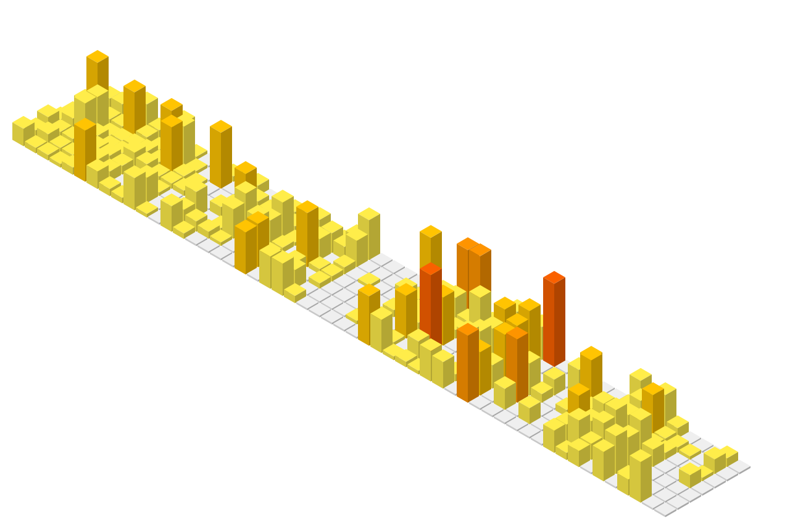

# Lee Sang Hyeok · 이상혁

Backend · Infra Developer

## About Me

백엔드 개발로 시작해, 지금은 서버를 직접 세우고 운영하는 인프라 쪽을 공부하고 있습니다.  
최근에는 직접 만든 모의 거래소를 운영 대상으로 삼아 Docker, VM, AWS 순서로 인프라를 구축하고, 일부러 장애를 내서 정말 복구되는지 확인했습니다.  
꾸준히 배우고, 맡은 일은 끝까지 책임지겠습니다.

contact  ·  [kljl6773@gmail.com](mailto:kljl6773@gmail.com)

## 주요 프로젝트

| 프로젝트 | 소개 | 기술 |
| :--- | :--- | :--- |
| [failstop](https://github.com/SanghyeokLee-KR/failstop) | 트래픽 급증과 DB 장애에도 버티는 거래소 인프라와 AI 관제 | Linux · AWS · Patroni |
| [sangkwon-platform-poly](https://github.com/sangkwon-poly/sangkwon-platform-poly) | 공공데이터로 창업 입지를 고르는 지도 기반 상권분석 플랫폼 | Spring Boot · Oracle · AWS |
| [appintoss-meetup](https://github.com/Appintos-Harmony/appintoss-meetup) | 악기 없이 친구와 트랙을 쌓아 한 곡을 만드는 합주 미니앱 | TypeScript · 앱인토스 |
| [SafetyNevi](https://github.com/SanghyeokLee-KR/SafetyNevi) | 재난문자를 지도 위 위험구역으로 그리고 대피소까지 안내 | Spring Boot · FastAPI · Kafka |
| [keep-nginx-alive](https://github.com/SanghyeokLee-KR/keep-nginx-alive) | 공격자를 막을 수 없는 CTF에서 nginx를 지켜 낸 가용성 방어 | Bash · systemd · AWS NLB |
| [high-throughput-image-pipeline](https://github.com/SanghyeokLee-KR/high-throughput-image-pipeline) | 작은 EC2 한 대로 처리율을 끌어올린 이미지 수집 파이프라인 | Python · asyncio · Redis |
| [DeliveryPro](https://github.com/SanghyeokLee-KR/DeliveryPro) | 음식 주문부터 매장 운영, 라이더 배달까지 이은 배달 플랫폼 | Spring Boot · Oracle |
| [ai-lunch-curator](https://github.com/SanghyeokLee-KR/ai-lunch-curator) | 구내식당 식단표를 AI로 정리해 평일 Teams로 보내는 알림 | FastAPI · Docker · GitHub Actions |
| [DevHub](https://github.com/SanghyeokLee-KR/DevHub) | 코드와 UI를 공유하고 실시간으로 소통하는 개발자 커뮤니티 | Spring Security · WebSocket |
| [polytalk](https://github.com/SanghyeokLee-KR/polytalk) | 서버도 메시지 내용을 볼 수 없는 1:1 종단 간 암호화 채팅 | Java · ECDH · AES-GCM |
| [kopo-ecommerce-evolution](https://github.com/SanghyeokLee-KR/kopo-ecommerce-evolution) | 같은 쇼핑몰을 JSON, JDBC, Spring Boot로 다시 만든 비교 | Java · JDBC · Spring Boot |
| [BookRidge](https://github.com/SanghyeokLee-KR/BookRidge) | Java를 배우며 처음 만든 콘솔 기반 도서 관리 프로그램 | Java · JDBC · Oracle |

## 기술 스택

<table>
  <tr>
    <th align="center">언어</th>
    <th align="center">프레임워크</th>
    <th align="center">데이터</th>
    <th align="center">인프라 · 운영</th>
  </tr>
  <tr>
    <td align="center">
      
      
      
      
    </td>
    <td align="center">
      
      
      
      
      
      
    </td>
    <td align="center">
      
      
      
      
    </td>
    <td align="center">
      
      
      
      
      
      
      
      
    </td>
  </tr>
</table>

<picture>
  <source media="(prefers-color-scheme: dark)" srcset="profile-3d-contrib/profile-night-rainbow.svg" />
  <source media="(prefers-color-scheme: light)" srcset="profile-3d-contrib/profile-green-animate.svg" />
  
</picture>
